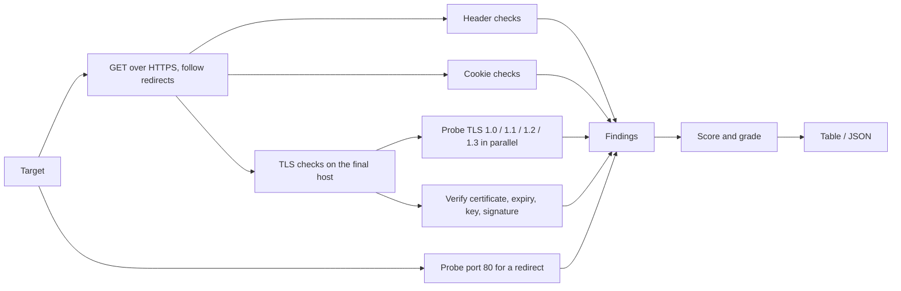

# sitegrade

[](https://github.com/kelvinngeno/sitegrade/actions)

A fast, dependency-free command-line auditor that grades a website's HTTPS
setup, security headers and cookies from **A+ to F**, and tells you exactly
how to fix each problem.

> **Intended use:** only audit sites you own or have permission to test.
> sitegrade sends a few ordinary requests and TLS handshakes, but you should
> still have the owner's consent.

## What it checks

| Area | Checks |
|------|--------|
| **Transport** | Site served over HTTPS; plain HTTP (port 80) redirects to HTTPS |
| **TLS** | Supported protocol versions (flags TLS 1.0/1.1, notes TLS 1.3); certificate trusted and matching the hostname; expiry date; key strength; signature algorithm |
| **Headers** | `Strict-Transport-Security`, `Content-Security-Policy`, clickjacking protection (`X-Frame-Options` or CSP `frame-ancestors`), `X-Content-Type-Options`, `Referrer-Policy`, `Permissions-Policy`, version leaks in `Server` / `X-Powered-By` |
| **Cookies** | `Secure`, `HttpOnly` and `SameSite` on every cookie set |

## Install

```bash
go install github.com/kelvinngeno/sitegrade/cmd/sitegrade@latest
```

Or build from source:

```bash
git clone https://github.com/kelvinngeno/sitegrade
cd sitegrade
go build -o sitegrade ./cmd/sitegrade     # sitegrade.exe on Windows
```

## Usage

```bash
sitegrade [flags] <site> [site...]
```

A site can be a hostname (`example.com`), `host:port`, or a full URL.

| Flag | Default | Description |
|------|---------|-------------|
| `-format` | `table` | `table` or `json` (JSON is always an array of reports) |
| `-o` | stdout | Write the report to a file |
| `-min-grade` | none | Exit with status 3 if any site grades below this (`A+`, `A`, `B`, `C`, `D`, `F`) |
| `-timeout` | `10s` | Timeout for each network operation |
| `-no-redirect-check` | `false` | Skip the plain-HTTP (port 80) check |
| `-version` | | Print version |

### Examples

```bash
# Audit one site
sitegrade example.com

# Several sites, JSON output
sitegrade -format json example.com example.org > report.json

# Use in CI: fail the build if the grade drops below B
sitegrade -min-grade B example.com
```

**Exit codes:** `0` success, `1` a site could not be audited, `2` usage error,
`3` a grade was below `-min-grade`, `130` interrupted.

### Example output

 Example output, auditing a local Python test server (plain HTTP, no security headers):

```
Target:  http://127.0.0.1:8000
Final:   http://127.0.0.1:8000/
Grade:   F   (score 19/100)

STATUS  CATEGORY   CHECK                    DETAIL
FAIL    transport  HTTPS                    The site is served over plain HTTP, so all traffic can be read or altered in transit.
FAIL    headers    Content-Security-Policy  Header is missing, so the browser has no policy limiting scripts and other content.
FAIL    headers    Clickjacking protection  Neither X-Frame-Options nor CSP frame-ancestors is set, so other sites can frame this page.
WARN    headers    X-Content-Type-Options   Header is missing or not set to nosniff, so browsers may guess content types.
WARN    headers    Referrer-Policy          Header is missing, so full page URLs may leak to other sites.
WARN    headers    Permissions-Policy       Header is missing, so powerful browser features are not explicitly restricted.
WARN    headers    Technology disclosure    Headers reveal software details: Server: SimpleHTTP/0.6 Python/3.13.15
PASS    cookies    Set-Cookie               No cookies were set on this response.

How to fix:
  - HTTPS: Serve the site over HTTPS with a valid certificate and redirect HTTP to it.
  - Content-Security-Policy: Start with: Content-Security-Policy: default-src 'self'
  - Clickjacking protection: Add: Content-Security-Policy: frame-ancestors 'self' (or X-Frame-Options: DENY).
  - X-Content-Type-Options: Add: X-Content-Type-Options: nosniff
  - Referrer-Policy: Add: Referrer-Policy: strict-origin-when-cross-origin
  - Permissions-Policy: Add, for example: Permissions-Policy: camera=(), microphone=(), geolocation=()
  - Technology disclosure: Remove X-Powered-By and hide version numbers in the Server header.
```

## How grading works

Every site starts at **100 points**. Each failed or weak check subtracts
points, and the score maps to a letter:

| Score | Grade |
|-------|-------|
| 100 | A+ |
| 90 - 99 | A |
| 80 - 89 | B |
| 70 - 79 | C |
| 60 - 69 | D |
| below 60 | F |

Some problems are **critical** and force an **F** whatever the score: no
HTTPS, an untrusted or expired certificate, or no TLS 1.2/1.3 support.
Cookie penalties are capped at 15 points in total so a site with many
cookies isn't graded to zero for flags alone.

Main penalties: missing CSP 20, missing HSTS 15, TLS 1.0/1.1 enabled 15,
no HTTP-to-HTTPS redirect 10, missing clickjacking protection 8, missing
`nosniff` 5, missing `Referrer-Policy` 4. The exact values live in
`internal/audit`.

## How it works



1. **Fetch.** One `GET` request, following up to five redirects. The site that
   answers last is the one audited. Certificate errors are ignored for this
   request so the headers can still be read; the TLS check reports them.
2. **Protocol probing.** Four handshakes run in parallel, each pinned to one
   TLS version, to see exactly which versions the server accepts.
3. **Certificate inspection.** A verified handshake checks trust and hostname.
   If that fails, a second handshake still reads the certificate so the report
   can describe it.
4. **Sanitised output.** Header values, cookie names and certificate fields are
   remote-controlled, so control characters are stripped before printing.
5. **Pure check functions.** Each check takes plain data and returns a
   `Finding`, which makes them easy to unit test and to extend.

## Project layout

```
cmd/sitegrade/        CLI: flags, wiring, exit codes
internal/audit/       checks, scoring and grading
internal/report/      table and JSON renderers
```

## Development

```bash
make test      # go test -race ./...
make cover     # coverage report
make lint      # golangci-lint
make cross     # Linux, macOS and Windows binaries in dist/
```

Tests run against local HTTPS servers, so they need no internet access.

## Limitations

- One `GET` of one URL: other pages may send different headers
- Doesn't test cipher suites, OCSP stapling, CAA records, HSTS preload or
  certificate transparency
- CSP analysis looks only at script sources, not the whole policy
- Pages that set headers with JavaScript or `<meta>` tags are not detected

## Roadmap

- [ ] Cipher suite and forward-secrecy checks
- [ ] HSTS preload status
- [ ] Deeper CSP analysis
- [ ] Markdown and SARIF output
- [ ] Prebuilt release binaries via GoReleaser

## License

MIT, see [LICENSE](LICENSE).
